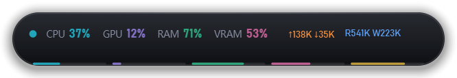
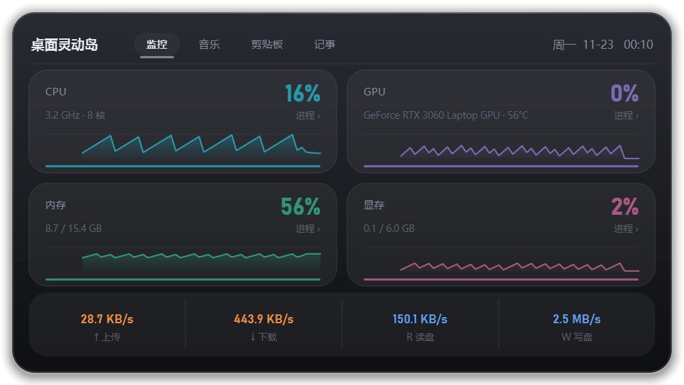
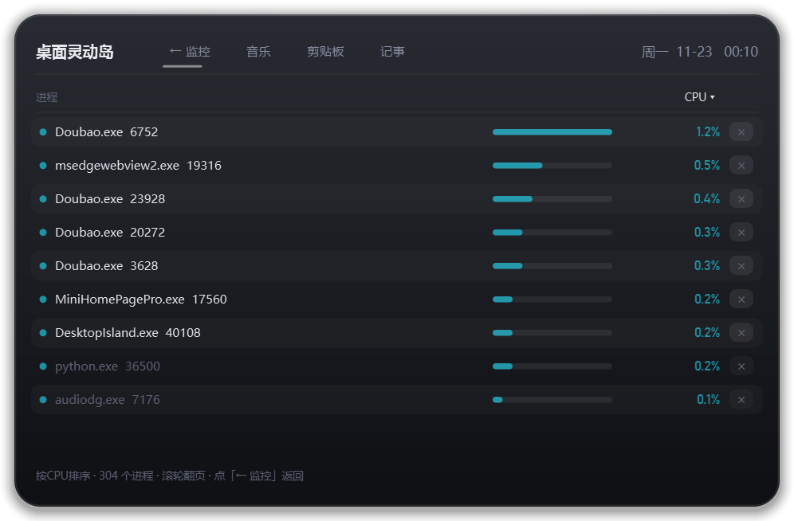
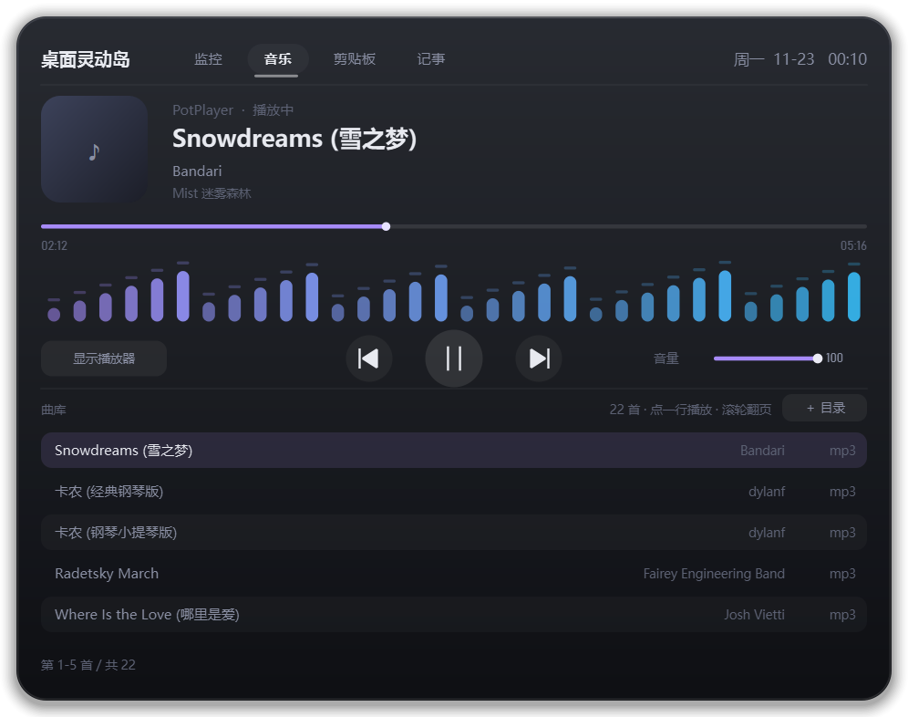
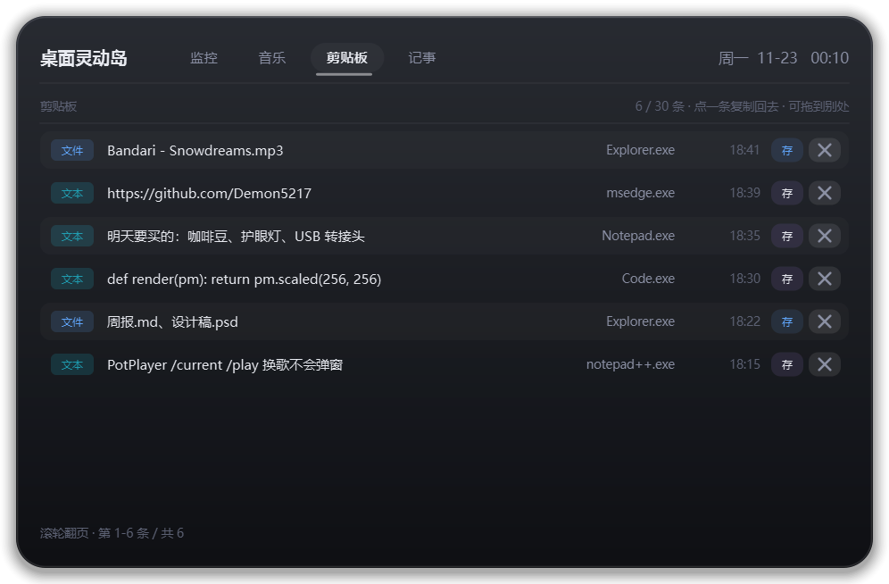
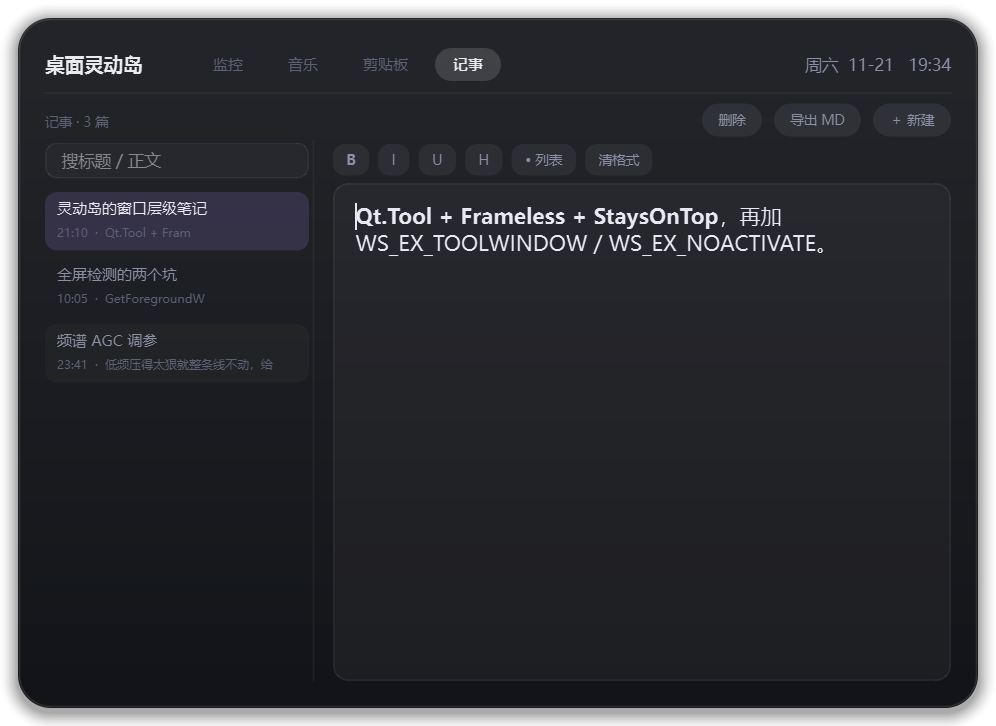

# 桌面灵动岛 · Desktop Island

一个自己画的 Windows 桌面「灵动岛」：屏幕顶部居中悬浮一条胶囊，鼠标移上去自动展开成面板，
平时不抢焦点、不进任务栏、不出现在 Alt+Tab，和 Wallpaper Engine 的动态壁纸互不干扰。

<!-- 截图位置 -->


用 PySide6 + Win32 API 手写，没有引入任何第三方 UI 框架或别人项目的代码。

> 名字只是借用「灵动岛」这个形态叫法，**与 Apple 没有任何关系**。

---

## 它能做什么

### 1. 系统监控
- CPU / GPU / 内存 / 显存四张卡片，实时的百分比、曲线、温度（NVIDIA 显卡走 NVML）
- 底栏是上传 / 下载 / 读盘 / 写盘四个速率
- **点任意一张卡片或底栏指标，就钻进这个指标的进程列表**：按该项排序、带条状图、可以直接结束进程




### 2. 音乐控制
- 读系统媒体会话（SMTC），任何遵守 SMTC 的播放器都能控：PotPlayer、Spotify、浏览器、VLC……
- 歌名 / 歌手 / 专辑 / 封面 / 进度，播放暂停、上一首、下一首
- **频谱律动**：抓系统输出（WASAPI loopback，不碰麦克风），32 段对数频带，还会从封面抽主色给整条胶囊上色
- **音量滑块只动播放器这个进程**，不动系统总音量
- 曲库和播放器同页：**目录完全由你自己指定**（点右上角「＋ 目录」选文件夹，或写进配置），不自动猜路径，点一行就用 PotPlayer 播；**默认后台播放，不弹播放器窗口**



### 3. 剪贴板历史
- 文本和文件都记，30 条，每条带来源进程和时间
- 点一条就复制回剪贴板，文件条目可以整组拖到资源管理器
- 每行还有「存」按钮，一键存成一条笔记



### 4. 记事本
- 富文本：粗体 / 斜体 / 下划线 / 标题 / 列表 / 清格式
- 停手 0.9 秒自动保存，标题和正文都能搜
- **一键导出 Markdown**（默认到 `文档\DesktopIsland\notes`，可在配置里改）



### 5. 桌面行为
- **自动贴顶居中**：启动就贴在屏幕顶部正中间；拖到靠顶部（顶边 40px 内）松手会自动回弹归位，拖到别处就自由摆放
- 右键胶囊或托盘菜单点「回到顶部居中 / 贴回屏幕顶部居中」，随时一键归位
- **全屏自动收起**：检测到有窗口铺满显示器（游戏、全屏视频、F11 网页）自动隐藏，退出全屏自动回来
- **开机自启**：托盘菜单勾一下，写 `HKCU` 的 Run 键，不碰系统服务、不要管理员
- 托盘菜单：显示 / 隐藏、全屏收起、PotPlayer 后台播放、开机自启、退出

---

## 安装

### 方式一：直接下 exe

到 [Releases](../../releases) 下载 `DesktopIsland.exe`，放到任意目录双击就行（建议 `%LOCALAPPDATA%\DesktopIsland\`）。
单文件打包，冷启动要约 10 秒（先解压到临时目录），之后常驻。

### 方式二：从源码跑

```powershell
git clone <本仓库地址> desktop-island
cd desktop-island
pip install -r requirements.txt
python main.py
```

想要「管理员模式」（逐进程精确网速）就右键用管理员身份跑 `管理员启动.bat`。

**环境**：Windows 10/11 + Python 3.13（3.11+ 应该也能跑）。

---

## 配置

配置在 `%APPDATA%\DesktopIsland\config.json`，第一次运行自动创建：

| 键 | 说明 |
| --- | --- |
| `pos` | 胶囊停靠位置（拖动后自动记） |
| `music_dirs` | 曲库目录，字符串数组；不填就是一个空曲库，点界面「＋ 目录」也能加（会写回这里） |
| `hide_on_fullscreen` | 全屏时自动收起，默认 `true` |
| `potplayer_bg` | 曲库点歌后台播放（不弹窗），默认 `true` |
| `export_dir` | 笔记导出 Markdown 的目录 |

从旧版（DesktopHub）升级的，首次启动会自动把旧目录的配置、剪贴板、笔记搬过来。

---

## 一些实现上的坑（也写在这里，省得别人再踩）

- **和 Wallpaper Engine 共存**：只创建普通顶层窗口（`Qt.Tool + Frameless + StaysOnTop`，加 `WS_EX_TOOLWINDOW` / `WS_EX_NOACTIVATE`），**完全不碰 `Progman` / `WorkerW` 桌面层**，所以壁纸渲染不受影响。
- **全屏检测**：`GetForegroundWindow()` 在 Win11 上可能长期返回 shell 的 `Windows.UI.Core.CoreWindow`，改成按 z-order 从最上层往下扫；进程非 DPI-aware 时窗口坐标是缩放后的逻辑值，所以判断用「宽/高各占显示器的比例」而不是像素。
- **PotPlayer 后台播放**：`/current /play` 复用实例换歌，然后 `SW_HIDE` 主窗口和「播放列表」窗口。冷启动后 3.5 秒那个播放列表窗口会自己再冒一次，所以隐藏要盯 20 秒而不是藏一次就收工。

更多开发细节见 [docs/DEVNOTES.md](docs/DEVNOTES.md)。

---

## 已知限制

- 只支持 Windows（Win32 API + SMTC + WASAPI 都是系统接口）
- GPU 数据靠 NVML，非 NVIDIA 显卡只显示占位
- 普通权限下「网络」是连接数排序，管理员权限才是真实速率（ETW 需要管理员）
- 酷狗不上报 SMTC，只能识别成「有声音」，播放控制走 PotPlayer
- 单文件 exe 冷启动约 10 秒；想快可以自己改成 `--onedir`
- 笔记导出 Markdown 是轻量转换，不覆盖表格、图片、多重嵌套列表

---

## 打包

```powershell
pip install pyinstaller
pyinstaller --noconfirm --onefile --windowed --name DesktopIsland `
    --icon tools\desktopisland.ico `
    --collect-submodules numpy --collect-submodules soundcard main.py
```

`--collect-submodules numpy` 是必需的：PyInstaller 对 numpy 2.x 的 hook 会漏掉 `numpy._core._exceptions`，不加就启动直接 ImportError。
别加 `--collect-submodules comtypes`：它在分析阶段会因为缺 `pywintypes` 直接失败。

---

## 许可

代码 MIT。打包的 exe 里含 Qt（PySide6），Qt 是 **LGPL-3.0**，按 LGPL 的要求允许用户替换 Qt 库；
如果需要严格合规，请用源码方式运行或自行构建 `--onedir` 版本。

---

<details>
<summary>English</summary>

A hand-drawn Windows "dynamic island" widget: a capsule at the top center of the screen that expands
into a panel on hover. It shows live CPU/GPU/RAM/VRAM and disk/network rates, drills down into a
per-process list for any metric, controls the system media session with a spectrum visualizer that
follows the album art colors, keeps a 30-entry clipboard history (text + files), and has a small
rich-text notebook with Markdown export. The window never touches the desktop layer, so Wallpaper
Engine keeps working.

Windows 10/11, Python 3.11+. `pip install -r requirements.txt` then `python main.py`.
</details>
